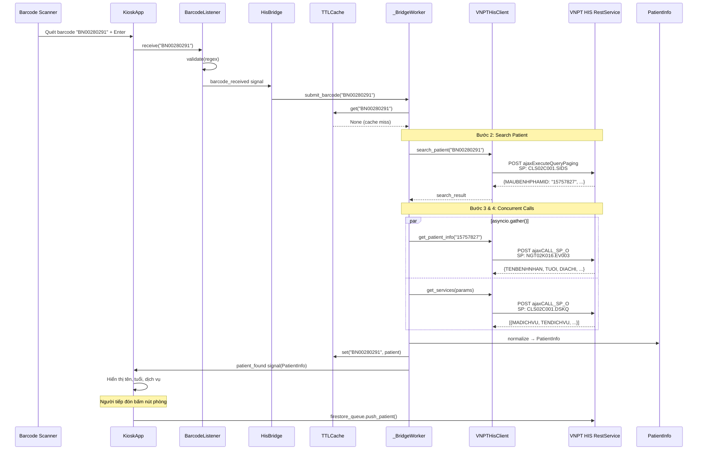
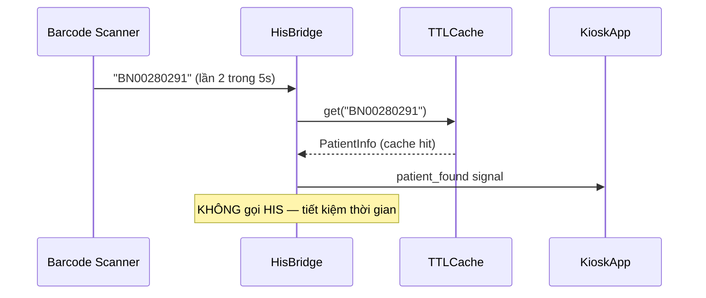
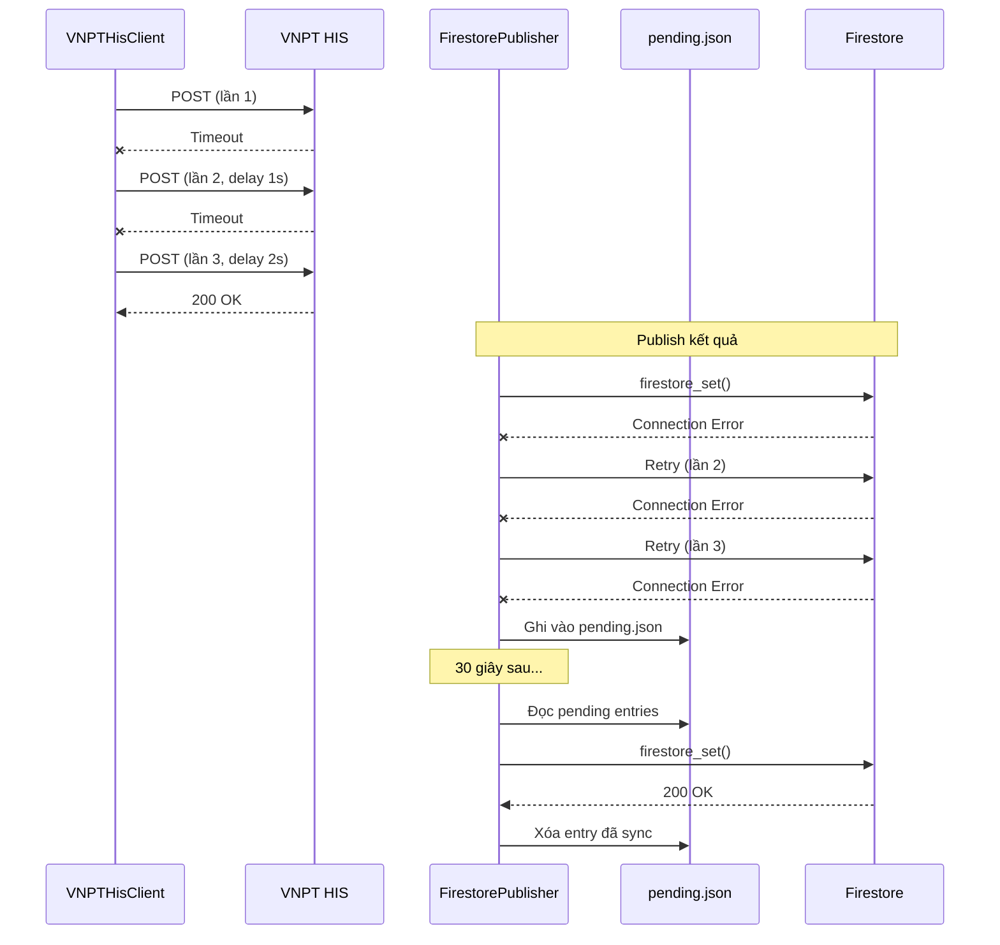
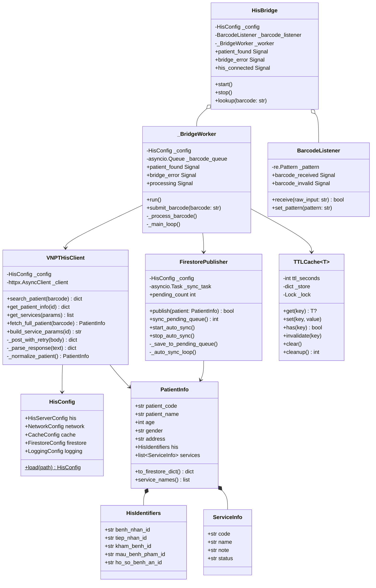

# HIS Bridge — Kiến trúc Module

## Tổng quan

HIS Bridge là module trung gian giữa Kiosk App và VNPT HIS RestService.
Thay thế hoàn toàn Selenium bằng giao tiếp REST API trực tiếp.

```mermaid
graph TB
    subgraph "Kiosk App (PySide6)"
        SCAN["Barcode Scanner<br/>USB HID + Enter"]
        KIOSK_UI["KioskApp UI<br/>Hiển thị BN + Nút phòng"]
    end

    subgraph "HIS Bridge Module"
        BL["BarcodeListener<br/>Validate + Signal"]
        CACHE["TTLCache<br/>5s dedup"]
        BRIDGE["HisBridge<br/>Orchestrator"]
        CLIENT["VNPTHisClient<br/>httpx.AsyncClient"]
        FS_PUB["FirestorePublisher<br/>Retry + Local Queue"]
        LOG["Logger<br/>his_bridge.log"]
    end

    subgraph "Session Watcher Service"
        SW["session_watcher.py<br/>Tray App + CDP websocket"]
        CFG["config.yaml<br/>YAML config file"]
    end

    subgraph "External Services"
        HIS["VNPT HIS RestService<br/>bvhatinh.vncare.vn"]
        FIRESTORE["Cloud Firestore<br/>autoq_queues/*"]
        CHROME["Google Chrome<br/>Debugging Port 9222"]
    end

    SCAN --> BL
    BL --> BRIDGE
    BRIDGE --> CACHE
    BRIDGE --> CLIENT
    CLIENT --> HIS
    BRIDGE --> FS_PUB
    FS_PUB --> FIRESTORE
    BRIDGE --> LOG
    BRIDGE -.->|patient_found signal| KIOSK_UI
    KIOSK_UI -->|push_patient()| FIRESTORE
    
    CHROME -->|CDP read session/cookies| SW
    SW -->|Auto update credentials| CFG
    CFG -->|Read config| BRIDGE
```

## Sequence Diagram — Luồng tra cứu bệnh nhân



## Sequence Diagram — Cache Hit (quét trùng trong 5 giây)



## Sequence Diagram — Lỗi mạng + Retry



## Class Diagram



## Nguyên tắc thiết kế

| Nguyên tắc | Áp dụng |
|---|---|
| **Single Responsibility** | Mỗi module chỉ làm 1 việc: client gọi API, publisher push Firestore, cache quản lý TTL |
| **Open/Closed** | Thêm stored procedure mới chỉ cần sửa `config.yaml` — không sửa code |
| **Dependency Inversion** | HisBridge phụ thuộc vào HisConfig interface — không hardcode URL/SP |
| **Don't Repeat Yourself** | `_post_with_retry()` dùng chung cho tất cả API calls |
| **Fail Gracefully** | Mất mạng → retry → local queue → auto-sync khi phục hồi |
